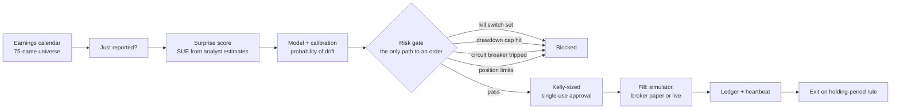

<p align="center">
  
</p>

<p align="center">
  
  
  
  
</p>

<p align="center"><b>A research engine and an autonomous trading bot for post-earnings drift.<br>It tests ideas the honest way, then trades the survivors: in a simulator, on your broker's paper account, or live when you arm it.</b></p>

---

## What it does

When a company beats or misses earnings, its stock tends to keep drifting the same way for weeks. That's **post-earnings announcement drift (PEAD)**. Meridian does two jobs:

1. **Research.** It measures the effect on real data: earnings surprise built from analyst estimates, cost-aware backtests, and explicit audits for the biases that make backtests lie.
2. **Trading.** A bot runs after every market close. It reads new earnings, scores the names that just surprised, sizes positions, opens and closes them on a 20-day holding rule, and keeps a ledger. No manual steps.

## Your risk

**You trade at your own risk.** Meridian is open-source research software, not a broker, adviser or managed service, and nothing here is financial advice. You can lose money, including all the capital you give it; shorts can lose more than they cost. Backtests and past results do not predict future returns (the strategy failed three of its own pre-registered tests). Software, data feeds and broker APIs fail, and orders can fill late, partly or at bad prices. You are responsible for your account, taxes and the rules where you live. The authors accept no liability for losses. Start on the simulator, then broker paper, and only risk money you can afford to lose.

## Setup (about two minutes)

```bash
git clone https://github.com/RyFinance/meridian.git
cd meridian
scripts/setup.sh                # Python env, dependencies, .env
scripts/desk.sh                 # the desk: http://127.0.0.1:8420
```

The fitted model ships in `models/`, so the bot trades on day one without refitting. Then either run a cycle by hand or schedule it:

```bash
scripts/cycle.sh                # one cycle now (trades only after a completed NYSE session)
scripts/install_launchd.sh      # macOS: cycle Mon–Fri 16:20 New York, watchdog, desk always on
```

On Linux, run `scripts/cycle.sh` from cron at 16:20 America/New_York. The first cycle downloads price history, which takes a few minutes.

## The desk

A terminal-style desk with function keys (F1–F4, F9 refresh) and a command line at the bottom (type `help`):

- **Desk:** account, system health (kill switch, circuit breaker, heartbeat, scheduler), execution mode, marked equity curve, open positions, scored signals, upcoming earnings, decision tape.
- **Brokers:** link accounts and choose how the bot executes.
- **Research:** the forward test on this account, the 2021–2025 replay, pre-registered tests and Monte Carlo.
- **Setup:** what it does, your risk, a live readiness checklist (each missing step shows its fix), quick start, how to use it properly, per-broker live setup steps and the current settings.

## Brokers and execution modes

| Mode | What happens |
|---|---|
| **Simulator** (default) | Real prices, simulated fills. No broker needed. |
| **Read-only** | Simulator trades; your linked account's balances and positions show alongside. |
| **Broker paper** | Orders go to the broker's paper / sandbox / demo account. |
| **Live** | Real orders. Off until you opt in (below). |

| Region | Broker | Read | Paper orders | Live orders |
|---|---|:-:|:-:|:-:|
| US | Alpaca | ✓ | ✓ | ✓ |
| US | Charles Schwab | ✓ | none offered | ✓ |
| US · CA · Intl | Interactive Brokers (Client Portal Gateway) | ✓ | ✓ | ✓ |
| US | Tradier | ✓ | ✓ (sandbox) | ✓ |
| Canada | Questrade | ✓ | API orders not allowed for personal apps | ✗ |
| Intl | Saxo Bank | ✓ | ✓ (SIM) | ✓ |
| Intl | Trading 212 | ✓ | ✓ (demo) | ✓ (long only) |

Wealthsimple, TD Direct Investing, RBC Direct Investing, BMO InvestorLine, Fidelity and Vanguard have no public trading API, so they can't be linked.

Link a broker in the desk (F2) or set `MERIDIAN_<BROKER>_<PAPER|LIVE>_<FIELD>` in `.env`. Credentials stay in `bot/state/brokers.local.json` (mode 600, git-ignored). The desk binds to 127.0.0.1 only. Each broker lives in one file under `brokers/`; add a broker by subclassing `brokers.base.Broker` and adding it to `brokers.REGISTRY`.

### Going live

Live needs all three, each done by you:

1. `MERIDIAN_ALLOW_LIVE=yes` in `.env`
2. live credentials linked for that broker
3. the arm phrase typed in the desk, e.g. `LIVE ALPACA`

The arm is re-read from disk before every order, so switching back to the simulator stops the next order. Each live order is clipped to `MERIDIAN_LIVE_MAX_ORDER_USD` (default $500). The risk gate, kill switch, drawdown cap and circuit breaker apply in every mode.

## How the bot decides



## Research, done honestly

| Principle | In practice |
|---|---|
| **Pre-register before looking** | Each experiment fixes its universe, rule, evaluation window and pass bar in writing before data access ([protocol](research_protocol_2026-09-18.md)) |
| **Net of costs, against real baselines** | Compared with buy-and-hold, cash at an attainable rate, and exposure-matched controls on common dates |
| **Measure the biases** | Survivorship, look-ahead and cash-basis Sharpe inflation are each quantified, not just mentioned |
| **Keep the failures** | Failed hold-outs stay in the record. A used hold-out is never reused |

## What it found

- **Survivorship bias is worth ~16 points a year.** Backtesting on today's S&P 500 members inflated CAGR by about 16 points annually.
- **A 1.4 Sharpe was really 0.7.** Early PEAD sweeps scored 1.34–1.44 on a cash basis with a zero risk-free rate. Crediting idle cash at T-bill rates cut it to about 0.70, which is now the bar.
- **Three pre-registered tests, three failures.** PEAD, multi-asset and crypto hold-outs didn't confirm an edge. New ideas are forward-tested on data that doesn't exist yet.

The bot keeps trading PEAD as a live forward test. That's how the strategy earns, or loses, its place.

## Layout

| Path | Purpose |
|---|---|
| `bot/` | The trading bot: signal pipeline, risk gate, execution (simulator + broker), heartbeat, watchdog, kill switch |
| `brokers/` | One adapter per broker, behind one small interface |
| `live_backtest/dashboard/` | The desk (FastAPI + plain JS, no build step) |
| `earnings/` · `signals/` · `ml/` | SUE, features, ensembles, calibration |
| `risk/` · `circuit_breaker/` | Limits, Kelly sizing, market-stress breakers |
| `backtest/` · `live_backtest/` | Backtest engine, metrics, replays |
| `research/` · `reports/` | Research code and written findings (large datasets are re-pulled by the `data/` scripts) |
| `models/` | The fitted production model |
| `scripts/` | setup, desk, cycle, launchd install |

Tests: `.venv/bin/python -m pytest tests`. Tests that need the large research datasets skip when those aren't present.

---

<p align="center">
  Built by <a href="https://x.com/slime2riches">@slime2riches</a> · <a href="https://slimecode.tech">slimecode.tech</a><br>
  <sub>Research software. Trading is risky, live trading most of all. Nothing here is financial advice.</sub>
</p>
